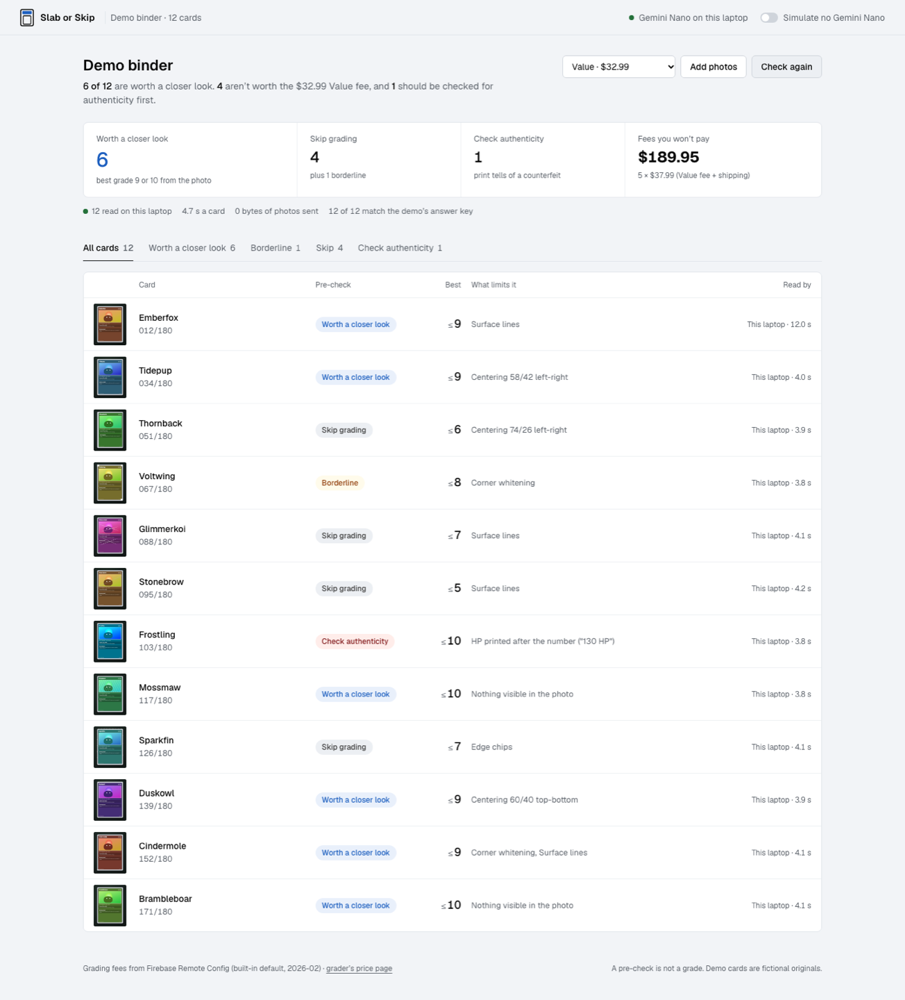

# Slab or Skip

**Pre-check a binder of trading cards on your own laptop before you pay to have them graded.**

Grading services charge per card, and most cards don't come back a 10. Slab or Skip looks at a photo of each
card, finds the flaw that caps its grade, and tells you which cards are worth a closer look, which to skip, and
which to check for authenticity first. The photos stay on the laptop: Gemini Nano reads them inside Chrome.
Only for the few cards worth it does the app go to the cloud, and then it sends just the card's name to look up
sold prices.

**Live app:** https://jone4865.github.io/slab-or-skip/ (desktop Chrome)
**Built for:** Google #BuildHybridAI 2026, with Firebase AI Logic hybrid inference



## What it does

1. **Measures what pixels can tell.** Code in the browser finds the card in the photo and measures centering
   (border widths, left-right and top-bottom) against published grading limits. It also measures corner whitening
   and edge chips, and runs a line detector for scratches and creases.
2. **Asks Gemini Nano what needs looking and reading.** Gemini Nano, on device, answers two narrow questions
   with structured JSON: is there a bright line across the card's surface, and what exactly is printed in the
   name, HP, move and number areas. Code turns the printed text into counterfeit tells (such as HP printed after
   the number, or a misspelled move).
3. **Combines them.** A surface flaw only caps the grade hard when the code's line detector and the model agree.
   The worst flaw sets the best grade the photo supports. Any counterfeit tell stops the card for an
   authenticity check before money is spent.
4. **Does the money maths for the cards worth it.** For a single card you choose, cloud Gemini with Google Search
   grounding finds recent sold prices (raw, PSA 10, 9, 8). The app weighs the expected graded value against the
   grading fee and shipping and says *send it* or *keep it raw*. The grading fee table comes from Firebase Remote
   Config, so it can be updated without a release.

## How the hybrid works

| Step | Where it runs | What leaves the laptop |
| --- | --- | --- |
| Centering, corners, edges, line detector | Your browser (plain TypeScript) | Nothing |
| Surface question, reading the printed text | **Gemini Nano in Chrome** (`InferenceMode.PREFER_ON_DEVICE`) | Nothing |
| Same two questions when Nano isn't available | Cloud Gemini through Firebase AI Logic, same prompt and schema | Two cropped JPEGs of the card |
| Sold prices | Cloud Gemini with Google Search grounding (`ONLY_IN_CLOUD`) | The card name and number as text |

- `src/ai.ts` builds every model with `getGenerativeModel(ai, { mode, inCloudParams, onDeviceParams })`. The
  on-device and cloud paths share one prompt and one response schema, and `response.inferenceSource` records which
  one answered each card. The UI shows it per card and counts photo bytes sent.
- Chrome downloads Gemini Nano in the background on the first check. The app never waits for that download:
  until the model is ready, cards go to the cloud.
- The **Simulate no Gemini Nano** switch forces `ONLY_IN_CLOUD`, so you can see the fallback a laptop without
  Nano gets.
- **Firebase App Check** protects the cloud calls, using reCAPTCHA (Essentials tier, score-based) in production
  and a debug token in local development.

## Results on the demo binder

The repo ships twelve fictional cards (`public/demo`, generated by `scripts/make-demo-cards.mjs`). Each card has a
known flaw and a known best grade, so the checks can be scored.

| Mode | Matches the answer key | Read on the laptop | Photo bytes sent | Time per card |
| --- | --- | --- | --- | --- |
| Hybrid, Gemini Nano available | 12 of 12 | 12 | 0 | about 5 s |
| Cloud fallback | 12 of 12 | 0 | about 1 MB in all | 2 to 10 s, depending on free-tier rate limits |

These numbers come from our own runs on one laptop. The detectors were tuned on this demo set, so treat them as a
working demonstration, not as accuracy on real photos.

## Run it locally

```bash
npm install
npm run dev        # http://localhost:5290
npm test           # domain tests: centering, grading, fees, assembling the read
```

The app uses the public Firebase web config in `src/firebase.ts`. To run it against your own Firebase project,
replace that config and enable Firebase AI Logic (Gemini Developer API) and App Check. For local development,
register an App Check debug token and put it in `.env.local`:

```
VITE_APPCHECK_DEBUG_TOKEN=<your debug token>
```

`scripts/run-in-chrome.cjs` drives the app in a desktop Chrome that already has Gemini Nano. It loads the demo
binder, runs the check and prints the results. Pass `--cloud` to test the fallback.

## Limits, stated plainly

- A pre-check is not a grade. It reads one photo, front only, and can only lower your expectations, not promise
  a 10.
- Photos need to be straight on, on a dark surface. Cards with a near-white border hide white wear; the app says
  so instead of guessing.
- The grade odds used in the money maths are a rule of thumb, not a grader's model.
- On-device inference needs desktop Chrome with Gemini Nano. In other browsers the app still works through the
  cloud path.
- Demo cards are fictional originals made with CSS shapes. No real card art, names or trademarks are used.

## Built with

Firebase AI Logic (`firebase` 13.4.0) · Gemini Nano in Chrome · Gemini on Google AI · Firebase App Check ·
Firebase Remote Config · React 18 · Vite · Vitest

## License

[Apache-2.0](LICENSE)
